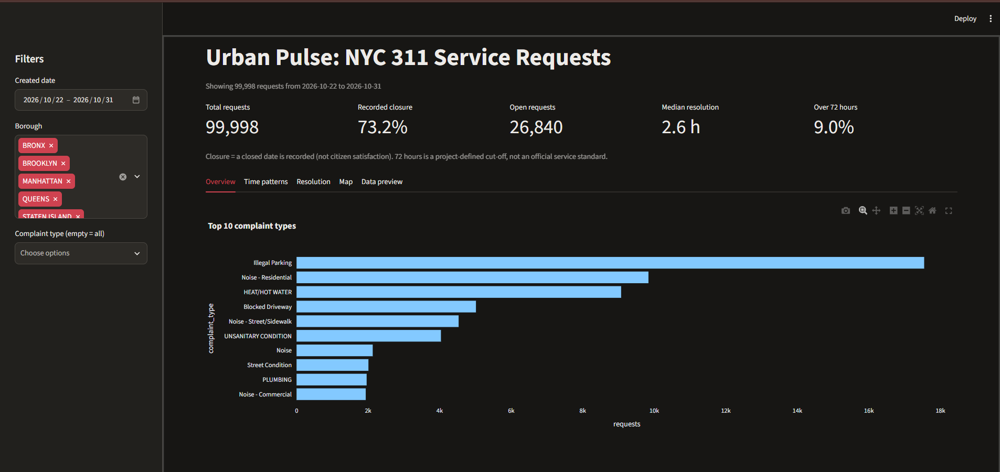
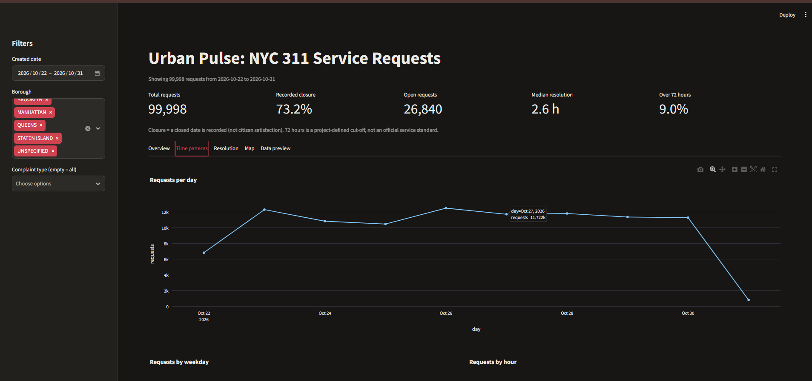
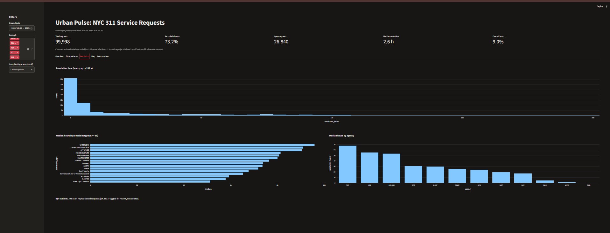
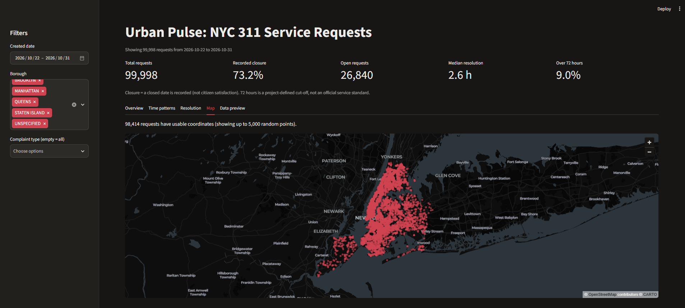
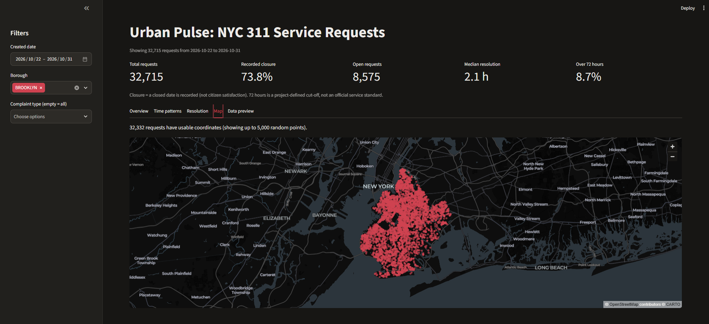
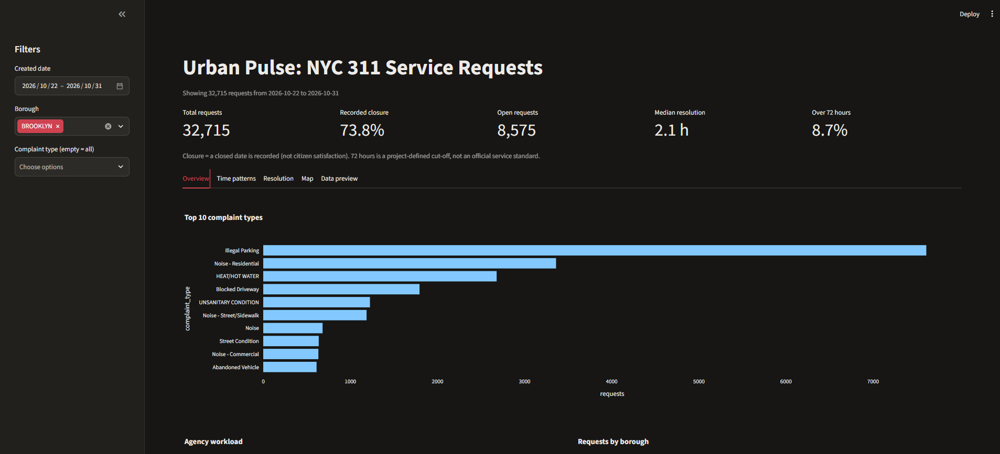

# Urban Pulse – NYC 311 Citizen Complaint Analytics

End-to-end analytics pipeline on NYC 311 service requests: API extraction → cleaning → statistics → PostgreSQL → SQL analysis → Streamlit dashboard.



## 1. Data source
- **Source:** NYC Open Data – 311 Service Requests from 2020 to Present (`erm2-nwe9`), via the Socrata API
- **Extracted:** 125,000 rows, 10 fields, in pages using `$limit` / `$offset`
- **Window:** 22 Oct 2026 – 31 Oct 2026 (most recent records at extraction time)

## 2. Pipeline
| Stage | File | Tool |
|---|---|---|
| Extraction | `extract_311.py` | Python, requests (Google Colab) |
| Cleaning | `notebooks/01_NYC311DATA_01_data_cleaning.ipynb` | pandas |
| Statistics & EDA | `notebooks/02_NYC311DATA_Stage2_02_eda_statistics.ipynb` | pandas, matplotlib |
| Database load | `notebooks/03_load_to_postgres.ipynb` | PostgreSQL 17, psycopg2 |
| SQL analysis (15 tasks) | `Sql/analysis_queries.sql` | PostgreSQL |
| Dashboard | `app.py` | Streamlit, Plotly |

## 3. Cleaning log
| Step | Result |
|---|---|
| Raw rows extracted | 125,000 |
| Exact duplicates removed (pagination overlap) | 25,002 |
| Clean rows | 99,998 (unique `unique_key` verified) |
| Text cleaned | trimmed spaces; agency, borough, status upper-cased |
| Dates parsed | `created_date`, `closed_date` → datetime |
| Flag: closed before created | 93 rows (kept, resolution time set to empty) |
| Flag: coordinates outside NYC | 0 rows (1,584 rows have no coordinates) |
| Closed requests | 73,158 |
| Valid resolution times | 73,065 |
| PostgreSQL load check | CSV rows = DB rows = 99,998 ✅ |

## 4. Data dictionary
| Column | Type | Meaning | Source / derived |
|---|---|---|---|
| unique_key | BIGINT | Unique request ID (primary key) | Source |
| created_date | TIMESTAMP | When the request was made | Source |
| closed_date | TIMESTAMP | When it was closed (empty if open) | Source |
| agency | VARCHAR | Agency that handled it (e.g. NYPD) | Source |
| complaint_type | VARCHAR | Category of complaint | Source |
| descriptor | VARCHAR | More detail on the complaint | Source |
| borough | VARCHAR | NYC borough | Source |
| status | VARCHAR | Current status (CLOSED, OPEN…) | Source |
| latitude / longitude | DOUBLE | Location | Source |
| bad_dates | BOOLEAN | Closed before created | Derived (flag) |
| bad_location | BOOLEAN | Coordinates outside NYC | Derived (flag) |
| is_closed | BOOLEAN | A closed date is recorded | Derived |
| resolution_hours | DOUBLE | closed − created, in hours (valid rows only) | Derived |
| month / weekday / hour | INT / VARCHAR / INT | Time parts of created_date | Derived |
| is_outlier | BOOLEAN | IQR outlier on resolution_hours | Derived (EDA) |

## 5. Resolution-time statistics (n = 73,065)
| Mean | Median | Q1 | Q3 | Std dev | Pearson skew |
|---|---|---|---|---|---|
| 18.2 h | 2.6 h | 0.75 h | 19.2 h | 32.5 h | 1.44 |

Strongly right-skewed: most requests close within hours, a few take days. **Median is reported instead of mean.**
IQR outliers: 10,916 requests (14.9%), led by HEAT/HOT WATER. Outliers were **flagged, not deleted**, because long cases may be genuine.

## 6. Dashboard KPIs
| KPI | Definition | Value (all data) |
|---|---|---|
| Total requests | Distinct `unique_key` | 99,998 |
| Recorded closure | % of rows with a closed date | 73.2% |
| Open requests | Rows with no closed date | 26,840 |
| Median resolution | Median of valid `resolution_hours` | 2.6 h |
| Over 72 hours | % of valid resolution times > 72 h | 9.0% |

Closure means a closed date is recorded, not citizen satisfaction. 72 h is a project-defined cut-off, not an official service standard.

## 7. Key findings
1. **Illegal Parking** is the top complaint (17,546), then Noise–Residential (9,838) and HEAT/HOT WATER (9,074).
2. **NYPD (44.8%) and HPD (24.1%)** handle about 70% of all requests.
3. **Brooklyn** has the most requests (32,715), then Queens (22,701).
4. Demand peaks on **Fridays** (~23,600) and in the **late morning (10–12 h)**.
5. **Housing complaints are slowest**: WATER LEAK (median 95.9 h) and UNSANITARY CONDITION (91.0 h) are both high-volume and slow.
6. NYPD closes fastest (median 1.3 h); HPD is slow (55.3 h).
7. Closure rate is highest in Queens (77.2%) and lowest in the Bronx (69.2%).

## 8. Limitations
- Only **10 days** of data (22–31 Oct 2026), so no monthly or seasonal trend is possible.
- **Right-censoring:** requests still open at extraction have no resolution time, so the longest cases are missing and the true median is likely higher than 2.6 h.
- 25,002 duplicate rows came from pagination overlap during extraction; they were removed, leaving 99,998 unique records.
- 311 data shows **reported** problems, not all problems in the city.
- Agencies differ in case complexity and how they record closure (e.g. DOB median of 0 h suggests same-time administrative closures).
- Recorded closure does not prove the problem was actually solved.
- **PostgreSQL** was used instead of the suggested MySQL; the SQL is standard and equivalent.

## 9. How to run
1. Install PostgreSQL 17 and Python 3.12.
2. Install libraries: `pip install -r requirements.txt`
3. Create a `.env` file (not included, for security):
   ```
   DB_HOST=localhost
   DB_PORT=5432
   DB_USER=postgres
   DB_PASSWORD=your_password
   DB_NAME=urban_pulse_db
   ```
4. Create the database `urban_pulse_db` and run the `CREATE TABLE` at the top of `Sql/analysis_queries.sql`.
5. Run `notebooks/03_load_to_postgres.ipynb` to load the cleaned CSV.
6. Start the dashboard: `streamlit run app.py`

## 10. Screenshots
| Overview & KPIs | Time patterns |
|---|---|
|  |  |
| **Resolution** | **Map** |
|  |  |
| **Filter: Brooklyn (map)** | **Filter: Brooklyn (KPIs)** |
|  |  |

## Author
Arokiaprakash A. – GUVI AIML Program